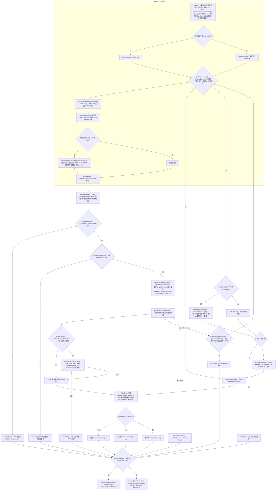

# GoPic

这是一个用 Go 构建的简单随机图服务器应用。它可以从文件或远程 URL 获取图片，支持压缩（Gzip 和 Brotli），并且使用轻量级缓存加速响应。

这个项目是我使用 AI 编写，它的诞生有以下几个原因：

- 给我的[博客](jmdonj.com)提供服务
- 测试 AI 编写代码的能力
- 测试普通人在 AI 的帮助下，能否顺利编写代码。

按我的测试结果来说，目前 AI 编写代码的能力处于半自动化的水平。举个例子来说，如果把编写代码比作组装机器，那么当前的 AI 就像是使用电动螺丝刀来拧螺丝。手动螺丝刀代表完全依赖人工操作，而电动螺丝刀则是在一定程度上提供了自动化帮助，例如自动生成代码片段、提供代码建议或自动完成某些任务，但整体过程仍然需要开发者的介入和指导。

对于稍微复杂的任务，AI 出错的概率不低。AI 可能难以全面理解项目背景、业务逻辑或特定领域的复杂性，导致生成的代码不符合实际需求。在处理异常情况或边界条件时，AI可能无法像经验丰富的开发者那样准确地预测和处理潜在的错误。

普通人使用 AI 编写出代码，可能可以运行，但不一定高效率运行。AI 生成的代码可能在逻辑上是正确的，但不一定是最优的。例如，算法的选择、数据结构的使用、循环的优化等方面可能不如经验丰富的开发者做得好。在内存管理和 CPU 使用方面可能不够高效，导致程序运行缓慢或占用过多资源。在安全性方面可能存在漏洞，如 SQL 注入、跨站脚本攻击等，需要额外的安全审查和加固。

AI 可以在一些简单的任务中提高开发效率，特别是在生成简单代码片段或是提供代码建议方面，但在处理复杂的项目和高要求的应用时，仍然需要开发者的深入参与和细致校验，结合专业知识和经验，以确保最终代码的质量和可靠性。

2026-09-22 更新：

近期 AI 的能力产生了飞跃式的进步，我不必一点点地跟进代码的编写。设置好相应的约束，它就能编写出一大段让我满意的代码。AI 从电动螺丝刀变成了锁螺丝机器人。

2026-10-26 更新：

将 Go 工具链从 1.27.1 升级到 1.27.3，依赖更新到最新版本，修复近期的 CVE。

## 一、特性

- **图片来源**：支持从本地文件系统或远程 URL 加载图片。
- **压缩支持**：自动启用 Gzip 和 Brotli 压缩以优化带宽，压缩响应对应声明 `Content-Encoding`；首页响应额外声明 `Vary: Accept-Encoding`。
- **内容协商**：按 `Accept-Encoding` 的 q 值选择编码，`q=0` 视为显式拒绝，`*` 通配符在未显式列出该编码时生效；编码名大小写不敏感，q 值相同时优先 Brotli。
- **图片缓存**：使用 [Ristretto](https://github.com/dgraph-io/ristretto) 缓存按编码处理后的图片数据（未压缩、Brotli、Gzip 各存一份），默认 1 小时后过期，避免图片源更新后长期返回旧图，并省去重复压缩。
- **首页缓存**：`index.html` 在服务端按「修改时间 + 文件大小」缓存，文件变化后自动重新读取并压缩；客户端可缓存首页 5 分钟。
- **配置灵活**：支持通过 `.env` 文件或环境变量进行配置。
- **访问控制**：基于 IP 和主机名的白名单机制（支持 IPv6），并提供整族放行与全放行令牌。
- **并发与网络抓取保护**：并发上限 100，等待超过 5 秒返回 503；每次网络图片抓取总时限 5 秒，响应体最多 4 MiB，不跟随重定向且不做重试。
- **随机图片**：每次访问 `/random-image` 时返回一张随机图片。
- **自定义主页**：可以通过 `index.html` 文件自定义首页内容。

## 二、系统要求

- Go 1.27.1 或更高版本（本项目基于此版本进行开发）

- 标准库：`bufio`、`bytes`、`compress/gzip`、`context`、`fmt`、`math/rand`、`mime`、`os`、`path/filepath`、`strings`、`sync`、`time`

- 第三方库：

  - [github.com/andybalholm/brotli](https://github.com/andybalholm/brotli)
  - [github.com/dgraph-io/ristretto](https://github.com/dgraph-io/ristretto)
  - [github.com/valyala/fasthttp](https://github.com/valyala/fasthttp)
  - [golang.org/x/sync](https://pkg.go.dev/golang.org/x/sync)（使用其中的 `semaphore`）

## 三、安装与运行

1. 克隆代码库：

   ```bash
   git clone https://github.com/cike-567/GoPic
   ```

2. 安装 Go 环境

   如果还没有安装 Go，需要先安装 Go 环境。可以从 [Go 官方网站](https://go.dev/dl/) 下载并安装 Go。

   安装完成后，您可以通过运行以下命令来验证 Go 是否已正确安装：

   ```bash
   go version
   ```

   确保返回的版本号与您安装的版本一致。

3. 安装依赖：
   进入克隆下来的项目目录，通常项目里会有一个 `go.mod` 文件，该文件定义了项目的依赖。

   ```bash
   cd 代码库名字
   go mod tidy
   ```

   `go mod tidy` 命令会自动下载项目所需的所有依赖包。

4. 构建应用程序：

   ```bash
   go build -o random_image_server
   ```

5. 准备需要的文件：

   按照「**配置**」部分的说明创建 `.env` 文件、CSV 文件和图片文件。如果不想使用 `.env` 文件，也可以使用环境变量。有一点要注意，不同种类的系统创建的 `.env` 文件有些许不同，不能通用。建议是在哪里运行就在哪里准备需要的文件。详细配置项说明见下文。

6. 运行服务器：

   ```bash
   ./random_image_server
   ```

7. 打开浏览器访问 `http://localhost:9090/` 就可以查看程序的效果。

## 四、配置

配置来源按下面的规则二选一，不会混用：

- 运行目录下存在 `.env` 文件时，只读取 `.env`；该文件存在但解析失败会直接终止启动。
- 不存在 `.env` 文件时，读取系统环境变量。

两条来源共用同一套校验流程，顺序固定为：先检查必需键是否齐全，再检查必需键的取值。
缺键、显式留空、取值非法三种情况都会**直接终止启动**，不会套用默认值掩盖配置错误。
默认值只对「未配置或留空」的**可选项**生效，见下表。

环境变量与 `.env` 文件中的键相同，仓库中有对应的示例文件可供参考：

| 变量                 | 必需 | 默认值   | 描述                                                         |
| -------------------- | ---- | -------- | ------------------------------------------------------------ |
| `BASE_URL`           | 是   | 无       | 图片的基础 URL 或路径；取值在启动时校验，非法即终止启动。    |
| `CSV_PATH`           | 是   | 无       | 包含图片文件名的 CSV 文件路径。                              |
| `IMAGE_URL_TYPE`     | 是   | 无       | 图片 URL 类型：`localpath` 或 `networkpath`。                |
| `PORT`               | 是   | 无       | HTTP 服务器端口，取值为 1 到 65535 的整数。                  |
| `PRELOAD_IMAGES`     | 是   | 无       | 是否在服务器启动时预加载图片（仓库中的示例 `.env` 当前设为 `true`）。 |
| `ENABLE_COMPRESSION` | 是   | 无       | 是否启用压缩（支持 Gzip 和 Brotli），取值为 `true` 或 `false`。 |
| `INDEX_HTML_PATH`    | 是   | 无       | 首页 HTML 文件路径，可自定义 HTML 文件的内容。               |
| `WHITELIST`          | 是   | 无       | 允许访问的 IP、主机名或放行令牌列表（逗号分隔）。            |
| `PRELOAD_TYPES`      | 否   | `brotli` | 预加载时写入缓存的数据（逗号分隔，可选 `brotli`、`gzip`、`raw`）。 |
| `GZIP_LEVEL`         | 否   | `-1`     | Gzip 压缩级别（-2 到 9：-2 仅 Huffman 编码，-1 默认压缩，0 不压缩，1 最快，9 压缩率最高）。 |
| `BROTLI_LEVEL`       | 否   | `6`      | Brotli 压缩级别（0-11）。                                    |

> **提示**：必需键必须显式写出，没有默认值。若原有 `.env` 省略过 `PORT`、`WHITELIST` 等键，
> 升级后会因「缺少必需配置项」而终止启动，需要把缺失的键补上。

- `BASE_URL`：设置图片存储位置。如果是本地路径，则指向本地目录；如果是网络路径（如 URL），则设置为完整 URL。取值在启动时按 `IMAGE_URL_TYPE` 校验，非法取值会终止启动：
  - `networkpath`：必须是 `scheme://authority[/path]` 形式，scheme 只允许 `http` 与 `https`（大小写不敏感）；authority 不得为空，也不得含 userinfo（`user:pass@host` 不会用于认证，只会把凭据写进启动日志）；不得含空白、控制字符、`?`、`#`、反斜杠；路径不得含 `.` 或 `..` 段，也不得含解码后可能改变层级的百分号编码。
  - `localpath`：目录必须存在且确实是目录（不是普通文件）；路径不得含 `..` 段。允许 `./images` 这类含 `.` 段的写法。
- CSV 行首尾空白会先被裁剪；裁剪后仍存在的控制字符、空白、`?`、`#`、反斜杠、非法百分号编码，以及解码后可能形成路径分隔符或 `.`/`..` 段的编码会被拒绝。普通文件名编码（如 `%20`、`%2E`）仍可用。
- `CSV_PATH`：配置图片文件名的 CSV 文件路径，该文件应包含图片文件名（每行一个）。文件缺失、为空、读取失败或所有条目均无效时，`/random-image` 会返回 503，详见「API 接口」。每个条目在启动装载时校验，**任一条目非法即终止启动**，错误消息包含文件名、行号与条目内容。校验分三层：
  - 格式（与平台无关，两种模式都检查）：空条目、控制字符、非法 UTF-8、`.` 或 `..` 段，以及解码后可能改变路径层级的百分号编码。
  - 网络模式专有：空白字符与 `?`、`#`、反斜杠（它们是 URL 的结构字符，会让路径与实际请求不一致）。
  - 本地模式专有：条目必须能作为本地文件名使用，按平台判断（Windows 拒绝保留设备名如 `NUL`/`CON`/`COM1`、盘符与 ADS 如 `a:b.png`、以及 `* | < > " \`；类 Unix 拒绝绝对路径与 `..`）。
    拼接后越出 `BASE_URL` 的条目（例如含 `..`）同样在装载阶段终止启动：否则条目可读到 `BASE_URL` 之外的文件。本地路径按目录包含关系判断，网络路径按协议、主机与路径前缀判断。
- `BASE_URL` / `INDEX_HTML_PATH`：必需键，必须写出且不能留空。
- `IMAGE_URL_TYPE`：必需键。`localpath` 表示图片来自本地文件系统，`networkpath` 则表示图片 URL 为网络路径；出现其它取值会终止启动，不会静默按 `localpath` 处理。
- `PORT`：必需键。取值必须是 1 到 65535 的十进制整数，不接受正负号、空格与小数；越界或非数字会终止启动。
- `PRELOAD_IMAGES`：必需键。取值为 `true` 或 `false`；出现 `yes`、`1` 等写法会终止启动，不会被静默当作 `false`。
- `ENABLE_COMPRESSION`：必需键。取值为 `true` 或 `false`。启用压缩可以减少网络带宽消耗，提高访问速度。
- `WHITELIST`：必需键，且不允许为空。逗号分隔，每一项会去掉首尾空白，空项被忽略。支持精确 IP、主机名，以及三个放行令牌，详见「访问控制」。
- `PRELOAD_TYPES`：可选项。仅控制启动预加载写入哪些数据，与 `ENABLE_COMPRESSION` 相互独立；后者只决定响应时是否压缩。逗号分隔，每一项去掉首尾空白，重复项只写一条缓存，取值为 `brotli`、`gzip` 或 `raw`（`raw` 表示原图）。未配置或留空时取默认值 `brotli`；出现其它值属于配置错误，启动时直接终止。
- `GZIP_LEVEL` / `BROTLI_LEVEL`：可选项。取值必须是整数且在合法范围内，否则启动时直接终止，不会用默认值掩盖错误配置；未配置或留空时分别取默认值 `-1` 与 `6`。

### 代码内固定值

下面这些值当前写在代码里，不能通过环境变量或 `.env` 调整：

| 项                           | 值                      | 说明                                                         |
| ---------------------------- | ----------------------- | ------------------------------------------------------------ |
| 图片缓存过期时间             | 3600 秒                 | `ServerConfig.CacheExpireSeconds`，见 `main.go`              |
| 并发上限                     | 100                     | 加权信号量的权重，见 `main.go`                               |
| 等待并发额度的最长时间       | 5 秒                    | `semaphoreWaitTimeout`，超时返回 503                         |
| 单次网络抓取总时限及读写超时 | 5 秒                    | `imageFetchTimeout`，用 `DoDeadline` 设置本次截止时间，禁用幂等重试 |
| 网络响应体上限               | 4 MiB（4,194,304 字节） | `maxImageResponseBytes`，读取过程中限制，等于上限允许        |
| 图片源重定向                 | 全部禁止                | 不请求 `Location`；301/302/303/307/308 返回错误              |
| 首页客户端缓存时长           | 5 分钟                  | `indexHTMLMaxAge`                                            |
| 图片缓存容量                 | 512 MiB                 | Ristretto `MaxCost`；另有 `NumCounters=5000`、`BufferItems=64` |
| 服务端读取超时               | 5 秒                    | `serverReadTimeout`                                          |
| 服务端写出超时               | 10 秒                   | `serverWriteTimeout`                                         |
| 单 IP 连接上限               | 100                     | `maxConnsPerIP`；超限连接返回 429                            |

并发上限与单 IP 连接上限是两个独立常量，当前取值同为 100，但二者没有联动关系：
并发上限是全局的加权信号量额度（`main.go`）；单 IP 连接上限由 fasthttp 在连接层单独执行
（`maxConnsPerIP`，见 `config.go`）。取值相同使得单个 IP 在占满全局并发额度之前
会先撞上连接上限，但这并非设计保证——调整任意一个都会改变上述先后关系。

## 五、API 接口

### （一） 获取主页

- **请求方式**: `GET`（`HEAD` 同样可用，响应体由服务器丢弃）
- **路径**: `/`（请求 URI 为 `//` 时，`fasthttp` 会将路径解析为 `/`，同样命中首页）
- **说明**: 返回主页 HTML 内容。`index.html` 在服务端按「修改时间 + 文件大小」缓存，文件变化后下次请求即重新读取并压缩。
- **缓存**: 成功响应为 `Cache-Control: private, max-age=300` 且带 `Vary: Accept-Encoding`，浏览器可缓存 5 分钟；使用 `private` 是为了不让共享缓存/CDN 绕过白名单对首页的拦截。
- **示例**: 访问 `http://localhost:9090/`。

### （二） 获取随机图片

- **请求方式**: `GET`（`HEAD` 同样可用，响应体由服务器丢弃）
- **路径**: `/random-image`
- **说明**: 返回一张随机选择的图片，`Content-Type` 按文件扩展名推断，无法识别时使用 `application/octet-stream`。响应禁止任何缓存（`no-store`），避免客户端复用旧响应；随机抽样允许连续请求返回同一张图片。
- **示例**: 访问 `http://localhost:9090/random-image`。

### （三） 状态码

| 状态码 | 触发条件                                                     | 响应体                                     |
| ------ | ------------------------------------------------------------ | ------------------------------------------ |
| 200    | 正常返回                                                     | HTML 或图片                                |
| 302    | 来源不在白名单                                               | 重定向到 `https://http.cat/599`            |
| 400    | 请求方法不是 `GET` 或 `HEAD`                                 | `Error when parsing request`               |
| 404    | 请求路径不是 `/` 或 `/random-image`                          | `404 not found`                            |
| 500    | 首页 HTML 读取失败、图片读取或下载失败、压缩失败             | 对应错误信息                               |
| 503    | 没有可用图片（CSV 缺失/为空/读取失败/所有条目均无效），或等待并发额度超过 5 秒 | `没有可用的图片` 或 `服务器忙，请稍后重试` |

服务器只提供只读接口，路由按路径分发、不看请求方法，因此用 fasthttp 的 `GetOnly` 在解析阶段就拒绝非 `GET`/`HEAD` 请求（400），避免它们进入业务链路取图、压缩并写入缓存。只有通过解析并进入 Handler 的 `GET`/`HEAD` 请求才会执行白名单鉴权；未通过白名单时返回 302。

### （四） 代码运行流程

下图对应当前实现：上半部分是启动阶段，下半部分是进入 Handler 后的单个请求处理链路。`handleRequest()` 在处理链路返回后，按「路径 + 状态码」统一设置缓存头；解析阶段被 `GetOnly` 拒绝的非 `GET`/`HEAD` 请求不会进入这条链路。



说明：

- 白名单鉴权在并发信号量之前执行：未通过鉴权的请求直接 302 重定向，既不占用并发额度，也不会在服务器繁忙时被改判为 503。
- 进入 Handler 的失败路径同样会经过这段统一处理：503、302、404、500 一律落到禁止缓存的分支；解析阶段拒绝的 400 请求不经过 `handleRequest()`。
- 首页的 `Cache-Control` 只在路径为 `/` 且状态码为 200 时生效，因此首页读取失败返回 500 时不会带着可缓存头。
- 缓存头在 `authMiddleware()` 返回之后设置：`ctx.Error` 会重置此前已设置的响应头，放在鉴权之后就可以覆盖 404、500、503 等错误响应，不必在每个处理器内部重复设置。

### 网络图片抓取策略

- 网络图片由 `fetchNetworkImage` 统一抓取，预加载与运行期缓存未命中均适用。仅接受 HTTP 200；收到 301、302、303、307、308 时拒绝，不访问 `Location`，也不在错误消息中回显该响应头。304 等其他非 200 状态同样失败。
- 客户端通过 `MaxResponseBodySize` 在缓冲读取过程中限制响应体为 **4 MiB**，不是下载完成后才检查；覆盖 Content-Length、chunked 和读到连接结束的响应，包括错误与重定向正文。该限制针对接收的响应体字节，不是图片解码后的像素内存限制。
- 使用 `DoDeadline` 为每次网络抓取设置 **5 秒截止时间**，保留读/写各 5 秒的上限，不重试。并发配额等待、图片压缩和写回下游不计入这次网络抓取的时间预算。
- 超限、超时、重定向拒绝及非 200 响应都不会写入图片缓存，不返回部分数据。运行期仍返回 500；预加载失败仍记录错误并继续后续图片。
- 本地图片仍由 `os.ReadFile` 读取，不受这两个网络限制影响。不新增环境变量；如果图源依赖重定向，需要改用能直接返回图片的地址。
- 4 MiB 是单个响应体上限，不是进程内存上限；并发下载、正文复制、压缩和缓存仍占用内存。禁止重定向也不等同于完整的内网访问隔离，初始图源的地址与网络权限仍由部署负责。

## 六、缓存机制

### （一） 图片数据缓存（服务端）

- 使用 [Ristretto](https://github.com/dgraph-io/ristretto)，键为「图片路径 + 压缩编码」，值为该编码对应的响应体（未压缩时为原图字节，Brotli/Gzip 为压缩结果），开销按字节数计算。
- 缓存中保存的是压缩后的结果，命中缓存时直接写出，不再逐请求压缩；同一张图片的不同编码各占一条缓存记录。
- 每个条目带 TTL，默认 3600 秒，到期后重新读取本地文件或重新下载；TTL 不会因为访问而续期。
- `PRELOAD_IMAGES=true` 时，启动阶段按同一 TTL 预加载：预热哪些数据由 `PRELOAD_TYPES` 决定（默认 `brotli`），配置几项就预热几份，重复项只写一条。该配置与 `ENABLE_COMPRESSION` 相互独立，因此启用压缩时若只配置 `brotli`，原图与 Gzip 都不预热。未预热的编码由首次请求按需生成并写入缓存。
- 缓存写入是尽力而为：高并发下 Ristretto 可能丢弃写入，此时只会导致下次重新加载，不影响本次响应。
- 未命中时的加载请求按「图片路径 + 编码」合并：同一张图片同一编码同时只有一个请求真正读取、压缩并写入，其余请求等待并共享结果；不同编码各自加载一次原始图片。失败结果同样共享且不写入缓存，下一次请求会重新尝试。
- 预加载函数返回前会等待所有写入生效，避免启动后立刻到达的请求把已预热的图片再加载一次。
- 合并只在本进程内生效；多实例部署时各实例仍会各自加载一次。

### （二） 首页 HTML 缓存（服务端）

- 缓存 `index.html` 的原始内容与 Brotli、Gzip 两种压缩结果。
- 通过文件的修改时间和大小判断是否失效，文件变化后重新读取并压缩一次。

### （三） 客户端缓存策略

缓存头在响应写出前按路径统一设置，完整链路见上面的「代码运行流程」图：

| 响应                                          | Cache-Control                         | 其它响应头                       |
| --------------------------------------------- | ------------------------------------- | -------------------------------- |
| `/` 且状态码 200                              | `private, max-age=300`                | `Vary: Accept-Encoding`          |
| 其余全部（含 `/random-image`、错误响应、302） | `no-store, no-cache, must-revalidate` | `Pragma: no-cache`、`Expires: 0` |

首页缓存 5 分钟意味着：编辑 `index.html` 后服务端立即使用新内容，但已经缓存了旧页面的浏览器最长 5 分钟内仍可能显示旧页面。

## 七、访问控制

白名单决定请求是否被放行，判定顺序如下：

1. 客户端是 IPv6 且白名单包含 `::/0`：放行全部 IPv6。
2. 客户端是 IPv4 且白名单包含 `0.0.0.0/0`：放行全部 IPv4。
3. 白名单包含客户端远程 IP（`RemoteIP`）：放行。
4. 白名单包含请求的 `Host`（按主机名比较，见下方说明）：放行。
5. 白名单包含 `*`：放行。
6. 以上都不匹配：重定向到 `https://http.cat/599`（302）。

说明：

- 白名单按逗号分隔，每一项会去掉首尾空白；空条目会被忽略（因此 `a, b` 与 `a,,b` 都能正确处理）。
- `WHITELIST` 是必需键，没有默认值：未配置、写成 `WHITELIST=` 或只有逗号（等于没有有效条目的空白名单），在 `.env` 与系统环境变量两种来源下都会终止启动。原因是空白名单会让每个请求都被 302，而日志里只有一行没有条目的 `Whitelist:`，很容易被误判成「访问被限制」而不是「配置写错」。
- `0.0.0.0/0` 与 `::/0` 按协议族分别生效，只配置其中一个不会顺带放行另一个协议族。
- **IPv6 地址不要写方括号**：白名单里的 `[::1]` 会被归一化保留方括号，而客户端 IP 经 `RemoteIP` 得到的是不带方括号的 `::1`，两者不相等，因此 IP 分支匹配不上。写 `[::1]` 只能靠请求的 `Host` 恰好带方括号才放行，一旦 `Host` 被改写成 `localhost:9090` 等其它形式就会被 302。要按 IP 放行本机 IPv6，写 `::1`。
- 这三个令牌是固定的字符串匹配，项目**没有实现通用的 CIDR 解析**。像 `192.168.1.0/24` 这样的网段写法不会生效，只会作为普通字符串参与精确匹配。
- 白名单同时检查远程 IP 和请求的 `Host`，两者任一如在白名单中即放行。
- 主机名比较前会做归一化：去掉端口与结尾点（IPv6 保留方括号），再按小写比较。因此 `WHITELIST=example.com` 能匹配 `Host: example.com:9090`，`WHITELIST=example.com:8080` 与 `example.com` 等价，配置者不能按端口区分访问。
- 归一化对 CIDR 与 `*` 令牌无影响，它们不含端口，仍按原样精确匹配。

> 部署在反向代理或 CDN 后面时，服务器看到的远程 IP 是代理的地址，白名单需要包含该地址才能正常工作。

## 八、项目结构

| 文件                | 职责                                                         |
| ------------------- | ------------------------------------------------------------ |
| `main.go`           | 入口：初始化缓存与并发信号量、加载配置、启动服务器           |
| `config.go`         | `ServerConfig`、常量、出站 HTTP 客户端、`.env` 与环境变量解析、白名单构造 |
| `server.go`         | 请求入口、并发信号量、路由分发、缓存头设置、服务器启动       |
| `handlers.go`       | `/`、`/random-image`、404 三个处理器                         |
| `indexhtml.go`      | 首页 HTML 缓存与 Brotli/Gzip 压缩工具                        |
| `images.go`         | 图片清单读取、随机选择、抓取与缓存、预加载                   |
| `auth.go`           | 白名单校验与鉴权中间件                                       |
| `negotiate.go`      | `Accept-Encoding` 解析与压缩方式协商                         |
| `main_test.go`      | 测试                                                         |
| `negotiate_test.go` | 内容协商的单元测试                                           |

## 九、测试

```bash
go test ./...
```

当前测试覆盖禁止重定向（目标请求数为零）、4 MiB 响应体上下边界（Content-Length/chunked/连接结束定界）、5 秒累计响应超时、对象池正文所有权、失败不入缓存及预加载继续、本地文件不受网络大小上限影响、图片抓取错误分类、图片缓存 TTL 过期、压缩结果按编码写入缓存与预加载、首页缓存失效、Brotli/Gzip/不压缩三条编码路径、`Accept-Encoding` 的 q 值与通配符协商、上游抓取超时、并发等待超时、随机取图、网络 URL 百分号编码与多语言条目、CSV 输入过滤、非 `GET`/`HEAD` 方法、白名单主机端口归一化、缓存击穿合并，以及按路径的缓存头策略。

## 十、未来计划

- 把并发上限、图片缓存 TTL、首页缓存时长等固定值改为可配置项。
- 支持任意 CIDR 网段，替换当前的三个固定放行令牌。
- 扩展缓存的配置选项，提供更多自定义功能。

## 十一、故障排除

如果遇到问题，请确保以下几点：

- `.env` 文件或环境变量已正确配置。注意两者不会混用：`.env` 存在时只读取 `.env`。
- 指定的 CSV 文件存在并包含有效的图片文件名。
- 服务器有权限读取相关文件。

常见现象与对应原因：

| 现象                                                         | 原因                                                         |
| ------------------------------------------------------------ | ------------------------------------------------------------ |
| 日志出现 `CSV 文件不存在`，或 `/random-image` 返回 503 且无可用图片 | CSV 缺失、为空、读取失败或所有条目均无效；补齐或修正 CSV 后重启即可 |
| 启动即打印 `配置错误: CSV 文件 ... 第 N 行条目 ... 非法` 并退出 | CSV 中存在非法条目：格式问题（控制字符、`.`/`..` 段、非法百分号编码）、网络模式的空白与 `?`/`#`/反斜杠、本地模式的平台非法文件名（保留设备名、ADS、非法字符），或条目拼接后越出 `BASE_URL`；按行号修正该条目后重启 |
| 访问被重定向到 `https://http.cat/599`                        | 来源不在白名单；部署在代理后时需把代理地址加入白名单         |
| 启动即打印 `配置错误: ... WHITELIST ...` 并退出              | 白名单为空（写成 `WHITELIST=`、只有逗号，或装载后无有效条目）；填入 IP、主机名或放行令牌 |
| 首页仍是旧内容                                               | 浏览器按 `private, max-age=300` 缓存了首页，等待 5 分钟或强制刷新 |
| 图片一直是旧图                                               | 图片缓存默认 1 小时过期，等待到期或重启进程                  |

## 十二、许可证

该项目根据 GPL 3.0 许可证授权。
